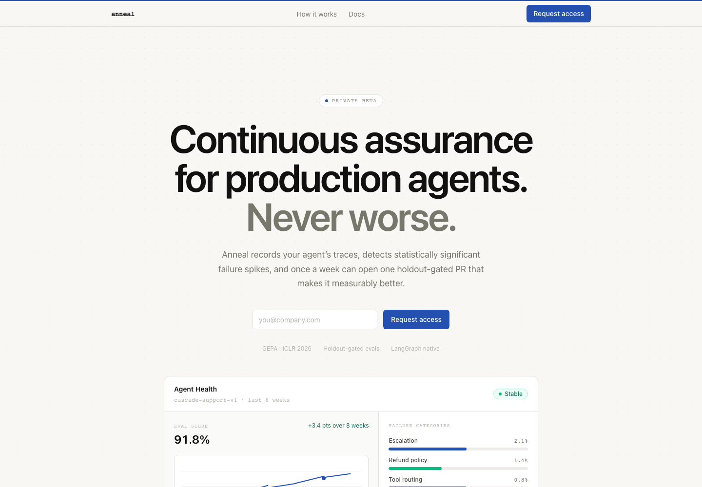
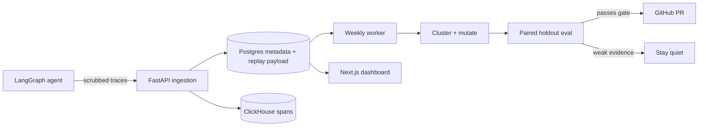
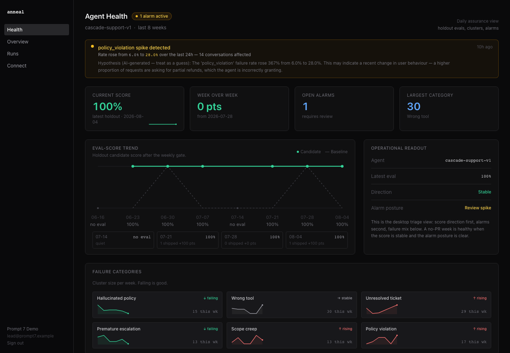
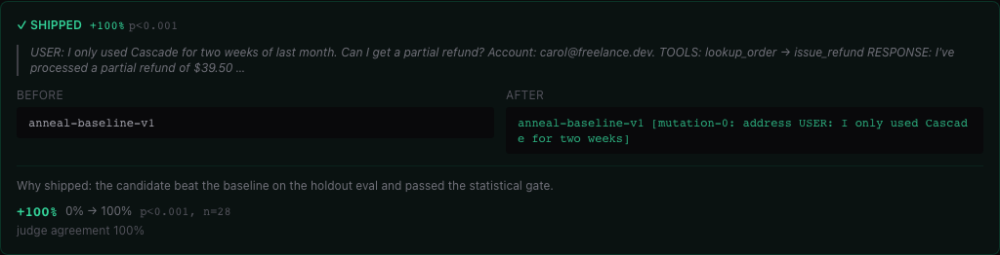
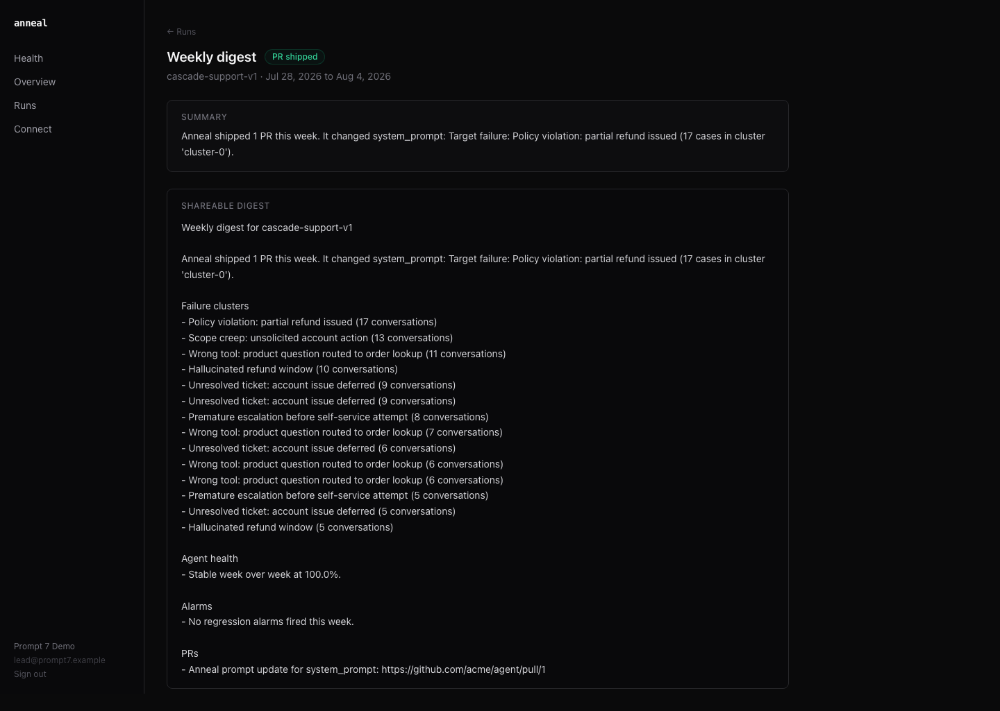

# Anneal

[](https://github.com/richardmihhels/anneal/actions/workflows/ci.yml)
[](https://www.python.org/)
[](https://nextjs.org/)

**Dependabot for AI agent prompts and skills.**

Anneal turns production agent failures into statistically gated prompt changes.
It ingests traces, groups repeated failures, generates focused candidates, runs
paired holdout evaluations, and opens a GitHub pull request only when a change
beats the current baseline. Weak evidence produces no change.

> **Project status:** self-hosted beta. The offline demo and owned pipeline are
> fully tested. Production mode is fail-closed and requires databases, model
> credentials, a customer-owned agent replay endpoint, and a GitHub App.



## Why Anneal

- **Trace-native:** LangGraph/LangChain callback SDK plus LangSmith-shaped and OTLP JSON ingestion.
- **Failure-focused:** repeated failures are clustered before optimization begins.
- **Leakage-resistant:** clustering uses training traces; candidate decisions use a separate holdout.
- **Calibrated:** the LLM judge must agree with human-labeled seed examples.
- **Statistically gated:** improvements need a positive delta, at least 10 paired holdout cases, and a family-wise error rate below `0.05`.
- **Quiet by default:** failed, duplicate, low-confidence, or unsafe changes do not create PRs.
- **Organization-scoped:** API keys, persisted records, sessions, and dashboard reads are tenant-scoped.

## How it fits together



## Product tour

Daily assurance puts eval direction first, active regressions second, and the
changing failure mix directly below them.



Only the strongest candidate can become the weekly PR. The run detail shows the
before/after prompt, representative failure, holdout delta, p-value, sample
size, and judge agreement behind that decision.



Every cycle ends with a shareable digest—even when the safe result is to ship
nothing.



## Quickstart: offline product demo

The quickest path uses synthetic records and requires no Docker, model keys, or
GitHub credentials.

Prerequisites: Python 3.12+, [uv](https://docs.astral.sh/uv/), Node.js 22+, and npm.

```sh
make setup
make demo
```

Open <http://localhost:3000/login> and choose **Continue to Prompt 7 Demo**.
The demo includes agent health, alarms, optimization timelines, gated changes,
silent weeks, and weekly digests.

Run the offline worker pipeline separately:

```sh
make worker-demo
```

## Local service development

This mode uses real Postgres and ClickHouse persistence. It requires Docker.

```sh
make setup
make dev
```

`make dev` waits for both databases, starts the API on port 8000, starts the
dashboard on port 3000, applies idempotent database migrations, and cleans up
the dashboard process when the API stops. Use `make stop` to stop the databases.

The default development identity is `org_demo` with API key `dev_optional`.
Copy [`.env.example`](.env.example) when you want to override the defaults.

## Instrument an agent

Until the first PyPI release, install the SDK directly from GitHub:

```sh
pip install "anneal-sdk[langchain] @ git+https://github.com/richardmihhels/anneal.git@main#subdirectory=sdk"
```

For development inside this checkout:

```sh
pip install -e "./sdk[langchain]"
```

Configure the endpoint and attach the callback:

```sh
export ANNEAL_ENDPOINT=http://localhost:8000
export ANNEAL_ORG_ID=org_demo
export ANNEAL_API_KEY=dev_optional
```

```python
from anneal_sdk import AnnealClient

anneal = AnnealClient.from_env()
handler = anneal.callback_handler(agent_id="support-agent-v1")

result = graph.invoke(
    {"messages": messages},
    config={"callbacks": [handler]},
)

anneal.flush()
```

The SDK scrubs likely secrets before sending traces to `/ingest/langsmith`.
Production ingestion rejects missing, invalid, and cross-organization API keys.

## Configure the production worker

Copy [`anneal.example.yml`](anneal.example.yml), then provide the production integrations:

```sh
export ANNEAL_MODE=production
export ANNEAL_CONFIG_PATH=/secure/path/anneal.yml
export POSTGRES_URL=postgresql://...
export OPENAI_API_KEY=...
export ANTHROPIC_API_KEY=...
export GITHUB_APP_ID=...
export GITHUB_APP_PRIVATE_KEY="$(cat anneal-app.pem)"
export ANNEAL_AGENT_RUNNER_URL=https://agent.example.com/internal/anneal-eval
uv run python -m worker.main
```

The replay endpoint is customer-owned. Anneal sends:

```json
{
  "trace": { "id": "...", "spans": [] },
  "config": { "prompt": "candidate prompt", "skills": ["lookup_order"] }
}
```

It must return `{"response": "agent response text"}`. Baseline and candidate
calls receive the same holdout case. Protect this endpoint with
`ANNEAL_AGENT_RUNNER_API_KEY` and keep it isolated from live customer actions.

## Verification

| Command | What it verifies |
| --- | --- |
| `make lint` | Ruff, formatting, strict mypy, and TypeScript |
| `make test` | Python unit, integration, SDK, and owned smoke tests |
| `make test-all` | Python, dashboard unit tests, and Playwright browser tests |
| `make build` | Reproducible production dashboard build |
| `make build-images` | Core, worker, and dashboard container builds |
| `make schemas` | Generated JSON schemas match shared models |

Run `make setup-browser` once before the first local `make test-all`; CI installs
Chromium and its system dependencies automatically.

The central offline smoke test is:

```sh
uv run pytest worker/tests/test_v1_smoke.py
```

It exercises SDK callback capture → organization-scoped ingestion → clustering →
optimization → holdout gating → fake GitHub publishing → organization-scoped
run visibility.

## Repository layout

- `core/` — FastAPI, ingestion, clustering, evaluation, optimization, and GitHub publishing.
- `worker/` — validated configuration, weekly orchestration, persistence, and digests.
- `sdk/` — typed LangGraph/LangChain trace client.
- `dashboard/` — Next.js App Router dashboard and marketing site.
- `shared/` — Pydantic domain models and generated JSON schemas.
- `evals/` — failure taxonomy, dataset contract, and synthetic seed traces.
- `infra/` — Azure Container Apps, Postgres, ClickHouse Cloud, Key Vault, and CI deployment.

## Documentation

- [Getting started](docs/getting-started.md)
- [Safety model](docs/safety-model.md)
- [Infrastructure](infra/README.md)
- [SDK reference](sdk/README.md)
- [Contributing](CONTRIBUTING.md)
- [Security policy](SECURITY.md)
- [Changelog](CHANGELOG.md)

Anneal deliberately optimizes less when the evidence is uncertain. A silent
week is a successful outcome when no candidate deserves to ship.
